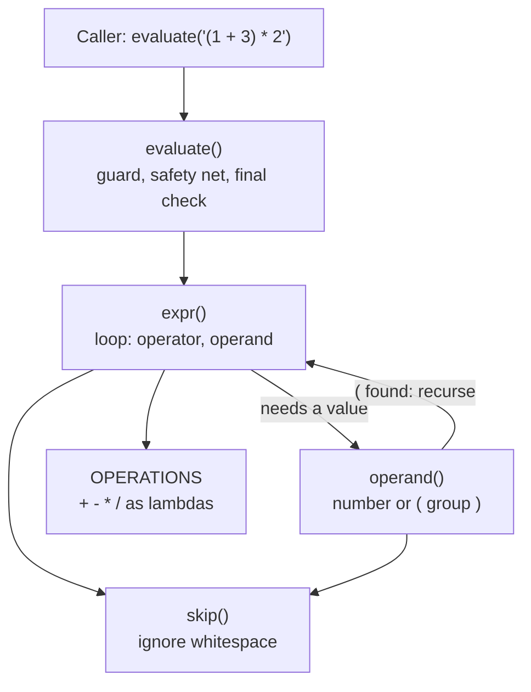

# Left-to-right arithmetic expression parser

`evaluate(expression: str) -> Optional[int]` returns the result, or `None` on any error.
No `eval`, `ast`, `tokenize` or `parser` is used.

## Architecture

A recursive-descent parser that reads the string once, left to right, with no separate token list.

| Part | Job |
|---|---|
| `skip(s, pos)` | Moves past spaces and returns the new position. Whitespace is handled in one place. |
| `operand(s, pos)` | Reads one signed integer, or a `( ... )` group by calling `expr()` again. |
| `expr(s, pos)` | Reads `operand (operator operand)*` and applies each operator straight away. |
| `OPERATIONS` | Maps `+ - * /` to lambdas. A new operator is one extra line. |
| `evaluate(expression)` | Entry point. Checks the input type, starts at position 0, rejects leftover text, and turns any exception into `None`. |

Each helper takes the string and a position, and returns `(value, new_position)`.
`None` as a value means "error", and it passes straight up the call chain.

## Example: `(1 + 3) * 2`

1. `evaluate` calls `expr`, which asks `operand` for the first value.
2. `operand` sees `(` and calls `expr` for the inside of the brackets.
3. The inner `expr` reads `1`, sees `+`, reads `3` and computes `4`. It stops at `)`.
4. `operand` checks the `)` and returns `4` to the outer `expr`.
5. The outer `expr` sees `*`, reads `2` and computes `4 * 2 = 8`.
6. `evaluate` checks nothing is left over and returns `8`.

## Decisions

* **Recursion for brackets.** A bracket group is just a smaller expression, so `expr` and `operand` call each other.
* **No precedence.** Each operator is applied immediately to the running value, so `1 + 3 * 4 = 16`. Brackets are the only way to change the order.
* **Return `None`, never raise.** Matches the required prototype.
* **Division is `int(a / b)`.** It truncates toward zero (`-7 / 2 = -3`). `a / 0` raises `ZeroDivisionError`, which `evaluate` turns into `None`.
* **Signs belong to numbers.** `3 - -2 = 5`. A sign must touch its digits, and a sign in front of a bracket (`-(1+2)`) is rejected, because the spec only allows signed numbers.
* **Explicit `0-9`.** `str.isdigit()` also accepts digits from other scripts.
* **`value is None`, not `not value`.** `0` is a valid result.

## Tests

`pip install pytest; pytest test_evaluate.py -v` runs parametrized cases for valid input, error input and non-string input.
